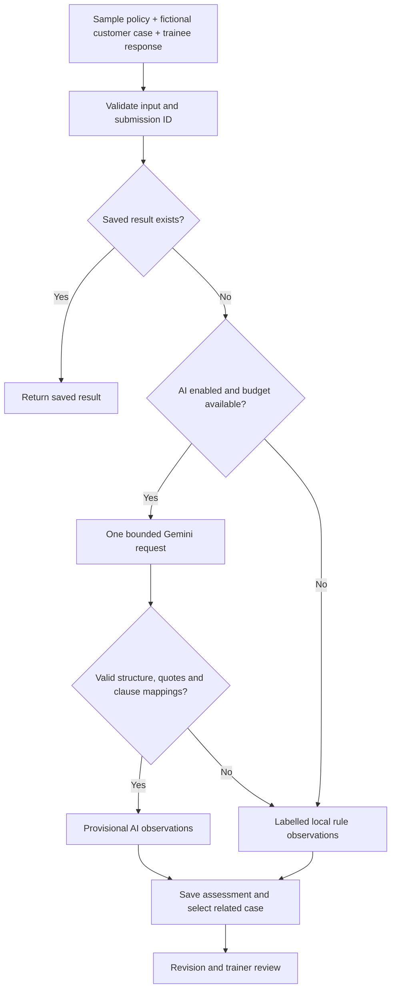

<p align="center"></p>

# SIRA Karmolab

**Practice workplace decisions. Explain the policy. Demonstrate your work.**

SIRA Karmolab is a working local prototype for **LearnSphere AI → SkillBridge**, developed by **SIRA Labs** for International AI Builders Congress 2026. Its first use case is e-commerce customer-service training for jobseekers, new employees, and trainers.

A trainee reads a fictional damaged-product complaint, writes a response, examines provisional policy-linked feedback, revises the response, and applies the lesson to a related case. Original work and trainer comments remain available in session-scoped history.

> **Current status:** a training prototype with local and hosted WSGI entry points and an optional, tested Gemini integration. There are no claims of independently measured learning gains or production readiness.

## Live demo

**[https://sira-karmolab-tatuhin09.azurewebsites.net](https://sira-karmolab-tatuhin09.azurewebsites.net)**

Hosted on Azure App Service Free (F1). Use fictional practice data. The free plan may sleep or reach shared quotas; the first visit can take longer. AI requests have a separate application-level daily cap, after which labelled local observations remain available.

## Why it exists

Knowing a refund policy is different from using it under customer pressure. A new employee might promise a refund before approval, omit a request for evidence, or ask again for information already supplied. Karmolab provides a safe practice environment with explanations and work samples a trainer can review.

The initial customer segment is e-commerce onboarding and vocational training. An organizational training licence or pilot is a proposed business model; demand, willingness to pay, and trainer-time savings remain unvalidated.

## What works today

- Bangla and English interfaces, responsive layouts, and a project logo.
- Four fictional scenario variants: an initial complaint, supplied evidence, a missing photo, and pressure for a refund guarantee.
- A two-attempt practice journey with a revision step and bounded follow-up-case selection.
- Own-word input and sample-response options where appropriate.
- Optional Gemini 3.1 Flash Lite feedback with structured output.
- Deterministic checks for finding types, exact quoted evidence, and policy-clause mappings.
- Clearly labelled local rule-based observations when AI is disabled, unavailable, rejected, or over budget.
- SQLite persistence for responses, revisions, assessment snapshots, trainer notes, and verdicts.
- Session-isolated history, duplicate-submission protection, and preserved drafts on request failure.

**Not implemented:** separate learner/trainer accounts, organization policy uploads, a production dashboard, automatic learning from trainer corrections, fine-tuning, multi-agent orchestration, vector retrieval, or production account management. The trainer controls shown in the prototype are not protected by a separate trainer role.

## Quick start: no API key required

Requirements: **Python 3.10+**, a modern browser, and an available local port. The application uses the Python standard library; no `pip install` is required. Python 3.14 was used for local verification. CI checks are configured separately.

```bash
git clone https://github.com/tatuhin09/sira-karmolab.git
cd sira-karmolab
python3 start_local.py
```

Open **http://127.0.0.1:8767/**. On Windows, use `py -3` instead of `python3` if needed.

```bash
python3 start_local.py --port 8770
```

Use the server rather than opening `dist/index.html` directly: history and assessment require the Python APIs. Press **Ctrl+C** to stop the server. Runtime databases are created automatically in `runtime/` and are not versioned.

## Optional Gemini review

AI is disabled by default. Local observations are rule based; they are not a local LLM.

1. Obtain a Gemini Developer API key for a project with an available model and quota.
2. Store it in a private local file outside the repository, using this format:

```dotenv
GEMINI_API_KEY=YOUR_PRIVATE_KEY
```

3. Start with explicit opt-in:

```bash
python3 start_local.py --ai --key-file /absolute/path/to/private-key.env --model gemini-3.1-flash-lite --daily-limit 2
```

The launcher reads only the named key from that file. It does not run shell code or automatically load `.env`. An already configured `GEMINI_API_KEY` environment variable is also supported when `--key-file` is omitted. `.env.example` is a configuration reference, not an automatically loaded file.

The model ID above was used in limited real tests. Availability and limits depend on the provider and project. A Gemini consumer/student subscription does not by itself verify API entitlements; inspect the API project's quota and billing. Do not assume this code guarantees zero charges.

The app counts attempted calls, including failed calls, against a persisted **UTC-day** budget. The launcher accepts a limit from 1 to 20. Repeated submissions with the same ID return the saved result without another model request. No automatic retries are made. A socket timeout is configured for provider requests; it is not a hard end-to-end SLA. The browser allows 20 seconds for assessment requests.

When a limit is reached, practice continues with explicitly labelled local observations. Do not delete or reset the budget database to conceal usage. Use fictional practice text: automatic personal-data redaction is not implemented.

## Practice walkthrough

1. Open the first exercise and read the customer's complaint and sample policy.
2. Choose a sample response or write your own reply.
3. Inspect feedback, quoted wording, and the referenced policy clause. The UI indicates whether AI analysis or local rules were used.
4. Revise your reply and continue to the related case.
5. Submit the second response and record a trainer review in the prototype controls.
6. Open **My practice / My work history** to inspect stored responses, revisions, and verdicts.

History belongs to a browser session cookie. A different session cannot access it through the normal history API. This is not an account system: losing the cookie loses normal access to that history, and clearing cookies does not delete server-side records.

## How it works



The policy is a small, fixed set supplied directly to the model. This is not a vector database or full RAG pipeline. Exact-quote and clause validation reject malformed evidence but do not establish semantic correctness. All findings retain `trainer_review_required` status.

See [architecture](docs/ARCHITECTURE.md), [API details](docs/API.md), [evaluation](docs/EVALUATION.md), and [security and deployment boundaries](SECURITY.md).

## Repository map

```text
start_local.py             Explicit local launcher and optional key-file reader
run.py                     Local loopback HTTP server and application API
cloud_app.py               Flask WSGI entry point for the hosted training demo
requirements.txt           Pinned Flask and Gunicorn dependencies
assessment.py              Sample policy, cases, local cues and case selection
ai_review.py               Gemini prompt, response schema, validator and budget
store.py                   Session-scoped SQLite persistence
core/research_contracts.py  Reused SIRA request/result contracts
core/provenance.json        Source commit, path and SHA-256
dist/                     Browser interface and logo
tests/                    Offline automated tests (no live API requests)
docs/                     Architecture, API and evaluation notes
.github/workflows/ci.yml   Offline checks on pushes and pull requests
```

## Tests

```bash
python3 -m pip install -r requirements.txt
python3 -m unittest discover -s tests -v
```

If Node.js is installed, check browser-script syntax:

```bash
node --check dist/app.js
```

Unit and HTTP tests use mocked model responses and temporary databases; they do not need a key or spend API quota. Prior end-to-end browser checks covered the practice flow, persistence, language switching, session isolation, failure recovery, and mobile layout. The historical live-test observations and their limits are described in [evaluation](docs/EVALUATION.md). The complete browser harness is not currently packaged as a portable test command in this repository.

## Data and privacy

Inputs are fictional cases and a sample-store policy, not a real merchant's refund policy. In AI mode, the current trainee response and bounded scenario context are sent to Google. Responses, revisions, and trainer notes remain in local runtime databases. Model failures retain fixed reason codes rather than raw provider errors or credentials.

Never publish `.env`, API keys, runtime SQLite files, real learner/customer records, or personal submission/account material. Runtime data, old submission drafts, generated video/PDF files, and private account screenshots are intentionally excluded from this source repository.

## Reuse and AI-assisted development

`core/research_contracts.py` was copied from the original SIRA codebase. [Provenance](core/provenance.json) records the source path, source commit, and content hash. The full original SIRA research, worker, scheduler, memory-promotion, and self-improvement systems are not part of Karmolab.

ChatGPT and Codex assisted with planning, implementation, tests, review, and writing. Gemini is the optional runtime review provider. Model suggestions remain subject to code validation and trainer review.

No blanket open-source licence is granted by this repository. Original-project and third-party rights remain with their respective owners. Contact the project owner before reuse beyond rights already granted by applicable licences.

## Roadmap and proposed pilot

- Strengthen the public training demo with account/role authentication and measured provider capacity.
- Add separate trainer access and organization-specific policies and cases.
- Build an independently labelled Bangla evaluation set, including negation and prompt-injection cases.
- Pilot with real trainers and learners under an appropriate data policy.
- Measure independently rated policy-compliant responses, repeated errors on changed cases, and trainer review time.

These are planned activities, not reported outcomes. The repository link is evidence of implementation; a hosted demo and video remain separate submission items.

## Azure training demo

The hosted entry point is `cloud_app:app`, served by Gunicorn using `deployment/azure-startup.sh`. The Azure App Service uses a Free (F1) Linux plan and HTTPS. See [deployment notes](deployment/README.md) for configuration, persistence, and free-plan limits. The local `start_local.py` workflow remains available.

Hosted-demo controls are for fictional practice, not verified trainer certification. A public URL does not make this a production learning-management system.
